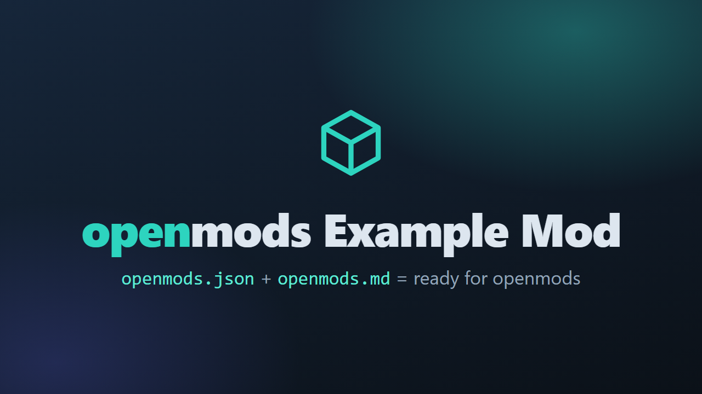

# openmods Example Mod

This is an example, not a real mod. It shows what a good `openmods.md` looks like: the page that players read on openmods. Every section is a suggestion: keep the ones that fit your mod.

## What it does

Tell players in a few sentences what your mod changes in the game. Start with the most useful part.

- Short lists work well.
- Write one idea per line.

## Screenshots

Show the mod in the game. Put the pictures into the repository, for example into `docs/`, and link them with a relative path:

## How to install

1. Install the mod loader of the game, if the mod needs one.
2. Open the latest release on GitHub and download the files.
3. Unzip them into the mods folder of the game.
4. Start the game.

To update the mod, replace its files with the files of the new release. To remove it, delete its folder. (Say here if removing the mod can harm saved games.)

## How to use

Explain the settings, keys and commands of your mod. Leave this section out if the mod needs nothing after the installation.

- Settings: (for example in the mod menu of the game)
- Keys: (for example F5 opens the calendar)

## Compatibility

- Game version: 1.6
- Works together with: (name mods that work well with yours)
- Does not work with: (name mods that conflict, if any)

## Known issues

None yet.

## How to build

Anyone can build this mod from its source code and check that the download matches it.

1. Install the tools: (for example the .NET 8 SDK)
2. Build it: (for example `dotnet build -c Release`)
3. Find the files: (for example in `bin/Release`)

A mod without code, for example one with only textures or settings files, says so: "Nothing to build: the release contains the files of this repository."

## Credits

Made by KintaroModding. MIT license: you may use, change and share this mod.
